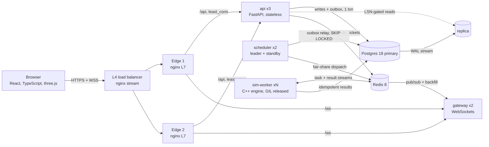

# Kessler

**Find the load and fault combinations that tip your services into self-sustaining failure, before production does.**


*Real engine output.* One checkout service is swept across load (columns) and database slowdown (rows): 240 deterministic simulations in 69 s on a 2-core laptop (`python scripts/readme_figure.py`).
- **Left:** with retries at every layer, 17 of 60 combinations recover on their own.
- **Right:** after applying Kessler's recommended fixes, 42 do.

## The problem

Most long outages are not caused by the first fault but by the system's *reaction* to it:

- **Retry amplification.** Three retries at each of three layers turn one click into 27 backend calls, at the exact moment the backend is slowest.
- **Wasted work.** Callers time out while callees keep working on requests nobody is waiting for.
- **Cold-cache collapse.** A flushed cache sends every read to a database too busy to refill it.

A short trigger becomes a state the system cannot leave by itself, a **metastable failure** (Bronson et al., HotOS '21; Huang et al., OSDI '22). Teams pick timeout, retry and pool values by intuition. Kessler measures them.

## What it does

1. **Describe** your services in a short `kessler.yaml`: instances, worker pools, queues, latency distributions, per-call timeouts, retries and jitter, retry budgets, circuit breakers, deadline propagation, caches, contention and autoscaling. Lint findings appear as you type. Each has a one-click fix and a resilience grade.
2. **Sweep.** A deterministic C++ discrete-event simulator runs your system across load levels and trigger sizes (slowdowns, error bursts, outages, traffic spikes, cache flushes). It draws a **metastability map** with the tipping boundary and names the mechanism that keeps failures alive.
3. **Fix and compare.** Kessler applies the recommended fixes as a new version and re-runs the *same* sweep with the same random seeds, so any difference comes from the change alone.
4. **Watch it live.** A three.js view of your topology shows request particles: errors in red, retries in amber. You can break things, fix them mid-run, and see the system respond in under a second.

## Architecture



The full write-up is [docs/DESIGN.md](docs/DESIGN.md). It covers requirements, capacity estimates, data model, failure modes and trade-offs.

## Engineering highlights

| Concern | How Kessler handles it |
|---|---|
| Load balancing | Two tiers. An L4 TCP balancer (nginx `stream`, PROXY protocol) sits in front of two L7 edges, which route `least_conn` with passive health checks and retry only idempotent requests. |
| Reverse proxy | TLS-ready edges serve the SPA with immutable hashed assets. They apply layered rate limits (per IP at the edge, per user in the API with GCRA in Redis), add a 2 s micro-cache on the status page and cache immutable reports at the edge. |
| Concurrency | The C++ engine is single-threaded per run for determinism, with a thread pool across runs. Python workers call it through ctypes, which releases the GIL, for real multi-core parallelism (2.7x on 4 threads). Everything else is async I/O. |
| Exactly-once effects | `Idempotency-Key` records commit in the same transaction as the work. A transactional outbox handles dispatch, and conditional state transitions make redelivered tasks no-ops. |
| Work distribution | Redis Streams consumer groups with idle reclaim and a dead-letter queue. Deficit Round Robin gives each tenant its fair share, measured with Jain's fairness index. |
| Coordination | The scheduler leader is elected through a Postgres advisory lock. Live-run ownership is a Redis lease with fencing tokens. |
| Fault tolerance | A worker dying mid-run is recovered by **deterministic replay** of the seed plus the event-sourced command log. The run continues with identical numbers. |
| Consistency | Reads use the replica only once it has replayed the client's last write (read-your-writes by LSN). Spec edits use `If-Match` optimistic concurrency. |
| Real time | One multiplexed WebSocket per tab with single-use tickets and HMAC topic tokens, so the gateway never needs a database lookup. Subscriptions backfill, then flush, with no gaps. Live frames are conflated, so slow clients get the latest frame. |
| Efficiency | Adaptive bisection finds the tipping boundary in O(log n) cells per row. A content-addressed result cache never simulates identical inputs twice. |
| Backpressure | Bounded queues everywhere. Workers read one task per free slot. Admission control returns 503 with `Retry-After`. The web client itself retries with full jitter under a retry budget. |
| Observability | Prometheus RED/USE metrics and product KPIs, multi-window SLO burn-rate alerts, a Grafana dashboard defined as code, OpenTelemetry traces carried through Redis messages, and JSON logs with request and trace IDs. |

## Measured so far (2-core Ryzen 3 3250U laptop)

| What | Result |
|---|---|
| Engine throughput, one thread | 6.2 M simulated events/s |
| Engine throughput, 4 threads | 16.5 M events/s (2.64x) |
| Python threads calling the engine | 2.72x speed-up on 4 threads (GIL released) |
| Queueing-theory validation | M/M/1 within 5 %; M/M/c within 4 % of Erlang-C |
| Tests | 31 C++ engine tests, 61 backend tests, 9 frontend tests |
| Frontend | Core bundle 138 KB gzip; three.js and the editor load only on the pages that need them |

End-to-end service-level numbers (time to first insight, fan-out latency, API latency under load) are measured with the load test once the stack runs. They are reported on the in-app status page and in [docs/PROGRESS.md](docs/PROGRESS.md).

## Run it

**Without Docker** (Windows, Linux or macOS). This needs Python 3.12, Node 22, and Postgres 18, Redis 8 and nginx, either portable builds in `./.tools` or on your `PATH`:

```bash
python -m venv .venv && .venv/Scripts/pip install -r backend/requirements.in -c backend/requirements.lock   # bin/ on Linux/macOS
cmake -S engine -B engine/build -G Ninja -DCMAKE_BUILD_TYPE=Release && cmake --build engine/build
(cd web && npm ci && npm run build)
python scripts/devstack.py up        # Postgres primary + replica, Redis, 3 api, 2 gateways, 2 schedulers, 2 workers, nginx L4 + 2x L7
open http://localhost:8080
python scripts/devstack.py down
```

**With Docker:**

```bash
docker compose up --build            # app on :8080, Grafana :3000, Prometheus :9090, Jaeger :16686
```

## Repository layout

```
engine/      C++20 simulator: DES core, resilience models, static analysis, C ABI, CLI, tests
backend/     Python: spec compiler + lint, api, gateway, scheduler, worker, migrations, tests
web/         React + TypeScript + three.js single-page app
deploy/      nginx (L4 + L7), Dockerfiles, Postgres replication, Prometheus, Grafana
scripts/     devstack (native multi-process stack), figure and dashboard generators
docs/        DESIGN.md (system design), PROGRESS.md
```

## Tests

```bash
./engine/build/kessler-tests                      # queueing theory + resilience behaviour
(cd backend && pytest -q)                         # spec, lint, planner, fairness, fan-out, security
(cd web && npx tsc -b && npx vitest run)          # types + client resilience logic
```
