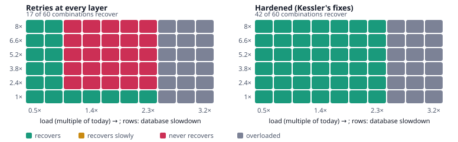
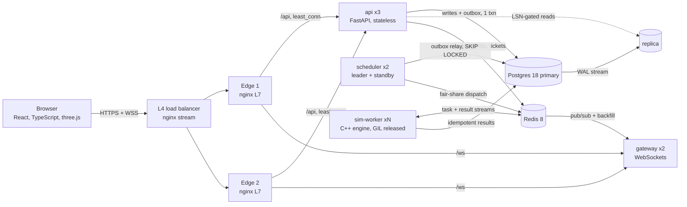

# Kessler

**Find the load and fault combinations that tip your services into a failure that outlives its trigger.**



*Real engine output.* One checkout service is swept across load (columns) and database slowdown (rows): 240 deterministic simulations in 69 s on a 2-core laptop (`python scripts/readme_figure.py`).
- **Left:** with retries at every layer, 17 of 60 combinations recover on their own.
- **Right:** after applying Kessler's recommended fixes, 42 do.

## The problem

In most long outages, the system's *reaction* to a fault does more damage than the fault itself:

- **Retry amplification.** Three retries at each of three layers turn one click into 27 backend calls while the backend runs at its slowest.
- **Wasted work.** Callers time out while callees keep working on requests nobody is waiting for.
- **Cold-cache collapse.** A flushed cache sends every read to a database too busy to refill it.

A short trigger becomes a state the system cannot leave by itself, a **metastable failure** (Bronson et al., HotOS '21; Huang et al., OSDI '22). Teams set timeout, retry and pool values by feel. Kessler measures what those values do under load.

## What it does

1. **Describe** your services in a short `kessler.yaml`: instances, worker pools, queues, latency distributions, per-call timeouts, retries and jitter, retry budgets, circuit breakers, deadline propagation, caches, contention and autoscaling. The editor lints as you type, offers a one-click fix for each finding and grades the spec's resilience.
2. **Sweep.** A deterministic C++ discrete-event simulator runs your system across load levels and trigger sizes (slowdowns, error bursts, outages, traffic spikes, cache flushes). It draws a **metastability map** with the tipping boundary and names the mechanism that keeps failures alive.
3. **Fix and compare.** Kessler applies the recommended fixes as a new version and re-runs the *same* sweep with the same random seeds, so any difference comes from the change alone.
4. **Watch it live.** A three.js view of your topology shows request particles: errors in red, retries in amber. You can break things, fix them mid-run, and see the system respond in under a second.

## Architecture



The full write-up is [docs/DESIGN.md](docs/DESIGN.md). It covers requirements, capacity estimates, data model, failure modes and trade-offs.

## Engineering highlights

| Concern | How Kessler handles it |
|---|---|
| Load balancing | Two tiers. An L4 TCP balancer (nginx `stream`, PROXY protocol) sits in front of two L7 edges, which route `least_conn` with passive health checks and retry only idempotent requests. |
| Reverse proxy | TLS-ready edges serve the SPA with immutable hashed assets. They apply layered rate limits (per IP at the edge, per user in the API with GCRA in Redis), add a 2 s micro-cache on the status page and cache immutable reports at the edge. |
| Concurrency | The C++ engine is single-threaded per run for determinism, with a thread pool across runs. Python workers call it through ctypes, which releases the GIL, for real multi-core parallelism (2.7x on 4 threads). Everything else is async I/O. |
| Exactly-once effects | `Idempotency-Key` records commit in the same transaction as the work. A transactional outbox handles dispatch, and conditional state transitions make redelivered tasks no-ops. |
| Work distribution | Redis Streams consumer groups with idle reclaim and a dead-letter queue. Deficit Round Robin gives each tenant its fair share, measured with Jain's fairness index. |
| Coordination | The scheduler leader is elected through a Postgres advisory lock (exported as `kessler_scheduler_leader`; the lock's connection names its holder). Live-run ownership is a Redis lease with fencing tokens. |
| Fault tolerance | If a worker dies mid-run, another worker **replays** the seed plus the event-sourced command log, so the run continues with identical numbers. Surviving workers reclaim orphaned batch tasks. Every long-lived loop is supervised (restart with backoff) and no log call can raise, so one crash cannot cascade. |
| Consistency | Reads use the replica only once it has replayed the client's last write (read-your-writes by LSN, from a header or a short-lived cookie, so any client gets it), and a miss on the replica is confirmed on the primary before a 404. Snapshots handed out with a stream position are fenced at the primary's WAL position, so no event falls between them. Spec edits use `If-Match` optimistic concurrency. |
| Real time | One multiplexed WebSocket per tab with single-use tickets and HMAC topic tokens, so the gateway never needs a database lookup. Subscriptions backfill, then flush, with no gaps. Live frames are conflated, so slow clients get the latest frame. |
| Efficiency | Adaptive bisection finds the tipping boundary in O(log n) cells per row. A content-addressed result cache never simulates identical inputs twice. |
| Backpressure | Bounded queues everywhere. Workers read one task per free slot. Admission control returns 503 with `Retry-After`. The web client itself retries with full jitter under a retry budget. |
| Observability | Prometheus RED/USE metrics and product KPIs, multi-window SLO burn-rate alerts, a Grafana dashboard defined as code, OpenTelemetry traces carried through Redis messages, and JSON logs with request and trace IDs. |

## Verified (2-core Ryzen 3 3250U laptop)

You can reproduce each result with the script named next to it.

**Against real outages** (`python scripts/replay_incidents.py`). Two public postmortems, rebuilt
as Kessler systems. Neither publishes numbers, so the replay sweeps every unknown (traffic, timeouts, retries, how
much slower the slow part became) over a grid of plausible values instead of tuning it. Kessler's
predictions face only the settings that reproduce each postmortem's stated facts.

| Outage and prediction | Result |
|---|---|
| **AWS DynamoDB, 2015 ([postmortem](https://aws.amazon.com/message/5467D2/))** | |
| Settings that reproduce the postmortem's facts | 35 of 64 |
| Kessler's static check flags the risk before simulating | 35/35 |
| Pausing requests, then resuming, ends the failure (what AWS did) | 35/35 |
| More metadata capacity prevents it | 26/35 |
| A lower renewal rate prevents it | 26/35 |
| A longer timeout alone prevents it | 1/35 |
| A longer timeout plus a queue that drops stale requests prevents it | 35/35 |
| Kessler's one-click fixes prevent it | 35/35 |
| **Facebook, 2010 ([post](https://engineering.fb.com/2010/09/23/uncategorized/more-details-on-today-s-outage/))** | |
| Settings that reproduce the post's facts | 18 of 24 |
| Kessler's static check flags the risk before simulating | 18/18 |
| Restoring all traffic at once collapses it again | 18/18 |
| Letting users back while the database copes recovers (what Facebook did) | 14/18 (median 4 min of simulated time) |
| A database sized for cold traffic prevents it | 16/18 |
| Kessler's one-click fixes prevent it | 16/18 |

What the misses mean:

- **A longer timeout alone (1/35).** The metadata queue holds more work than even a tripled timeout
  covers, so callers still time out and retry. Add a queue that drops requests older than the
  timeout and it works every time; Kessler's static check flags this case ("queue holds requests
  longer than callers wait").
- **Facebook's hardest corner.** The remaining misses all sit where a database that can serve only
  a third to a seventh of cold traffic sits behind a 200,000-key cache. The cache refills only as fast
  as that database answers misses, so recovery outlasts the 10-minute observation cap and a cautious
  ramp needs more than 30 simulated minutes, consistent with the 2.5-hour real outage.
- The models are reconstructions. They reproduce each postmortem's stated mechanism and order of
  events; neither company published its internal numbers.

**On a 45-service system** (the *Marketplace at scale* example: 64 calls, four caches, six databases).

| Check | Result |
|---|---|
| Flow conservation (`scripts/validate_engine.py`) | Every service's simulated arrival rate matches the static model: median deviation 0.32 %; the largest, +3.9 % at `carriers`, is retry traffic the static model leaves out |
| Request accounting | Arrivals equal outcomes (ok, error, shed, dropped) to within 0.25 %, boundary effects only |
| Determinism | Bit-identical results for the same seed, sequentially and on parallel threads |
| Saturation | The model predicts saturation at 1.49x today's load; the simulation is overloaded from 1.34x |
| Adaptive search | 25 of 60 cells simulated; **0 disagreements** with simulating every cell |
| Full stack (`scripts/e2e_check.py`) | 50-simulation sweep in 73 s, first result after 6.9 s; api p99 68 ms while the workers were saturated; stored results bit-identical to a local recomputation; a re-run served 50/50 from the cache in 2.2 s |
| Failover (`scripts/e2e_check.py --failover`) | A worker and then the scheduler leader killed mid-sweep: the standby took over and the sweep finished with every simulation exactly once and identical results. Then both WebSocket gateways and an api instance killed while a client watched: the stream reconnected and resumed with 50/50 results, no duplicates, ids in order, and 0 of 881 reads through nginx failed |

**Engine and tests**

| What | Result |
|---|---|
| Engine throughput, one thread | 6.2 M simulated events/s (5.4 M on the 45-service system) |
| Engine throughput, 4 threads | 16.5 M events/s (2.64x) |
| Queueing-theory validation | M/M/1 within 5 %; M/M/c within 4 % of Erlang-C |
| Memory | 5 MB growth over 145 simulations of the 45-service system |
| Tests | 33 C++ engine tests, 86 backend tests, 13 frontend tests |
| Frontend | Core bundle 138 KB gzip; three.js and the editor load only on the pages that need them |

## Run it

**Without Docker** (Windows, Linux or macOS). This needs Python 3.12, Node 22, and Postgres 18, Redis 8 and nginx, either portable builds in `./.tools` or on your `PATH`:

```bash
python -m venv .venv && .venv/Scripts/pip install -r backend/requirements.in -c backend/requirements.lock   # bin/ on Linux/macOS
cmake -S engine -B engine/build -G Ninja -DCMAKE_BUILD_TYPE=Release && cmake --build engine/build
(cd web && npm ci && npm run build)
python scripts/devstack.py up        # Postgres primary + replica, Redis, 3 api, 2 gateways, 2 schedulers, 2 workers, nginx L4 + 2x L7
open http://localhost:8080
python scripts/devstack.py down
```

**With Docker:**

```bash
docker compose up --build            # app on :8080, Grafana :3000, Prometheus :9090, Jaeger :16686
```

## Repository layout

```
engine/      C++20 simulator: DES core, resilience models, static analysis, C ABI, CLI, tests
backend/     Python: spec compiler + lint, api, gateway, scheduler, worker, migrations, tests
web/         React + TypeScript + three.js single-page app
deploy/      nginx (L4 + L7), Dockerfiles, Postgres replication, Prometheus, Grafana
scripts/     devstack (native stack: up, down, restart, kill), validation and end-to-end checks, generators
docs/        DESIGN.md (system design), PROGRESS.md
```

## Tests

```bash
./engine/build/kessler-tests                      # queueing theory + resilience behaviour
(cd backend && pytest -q)                         # spec, lint, planner, fairness, fan-out, security
(cd web && npx tsc -b && npx vitest run)          # types + client resilience logic
python scripts/validate_engine.py --template marketplace-at-scale   # simulator correctness at scale
python scripts/replay_incidents.py                 # two real outages, across plausible settings
python scripts/e2e_check.py [--failover]           # the running stack, end to end (and crash tests)
```
